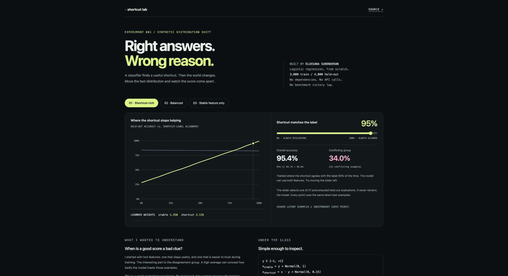

# Shortcut Lab

**Right answers. Wrong reason.** A small, interactive experiment in shortcut learning.

[Open the lab](https://eluxsana.github.io/shortcut-lab/) · [Methods](METHODS.md) · [Raw measurements](results.json)



I wanted to see a good average score come apart, in a setting small enough to understand every line. So I trained a logistic classifier with two features: a noisy but stable signal, and a shortcut that usually agrees with the label during training. Then I changed that agreement rate in held-out data.

This is an experiment about evaluation, not a new robustness method. It uses synthetic data and no employer code, private datasets, paid APIs, or pretrained models.

## What happened

At 95% test alignment, the shortcut-rich model gets **95.4% overall accuracy** but only **34.0% on conflicting examples**. At 5% alignment, its overall accuracy falls to **31.3%**. The balanced-data control gets **84.1%** at that shifted distribution.

The stable-feature-only control stays at **83.2%** across the sweep because its inputs do not change. That control assumes we know which feature is stable. The balanced control changes the training data; it is not an invariance algorithm.

Move the slider in the [live report](https://eluxsana.github.io/shortcut-lab/), compare the training choices, and inspect the learned weights. The report is a self-contained HTML file with no remote fonts, scripts, analytics, or network requests. The slider selects measured results; it does not pretend to train a model in your browser.

## Run it yourself

Python 3.9 or newer. Standard library only.

```sh
git clone https://github.com/eluxsana/shortcut-lab.git
cd shortcut-lab
python3 -m unittest -v
python3 train.py --out my-report
```

Open `my-report/index.html` in a browser. `my-report/results.json` contains all 63 evaluations, training-loss traces, weights, sample counts, confidence intervals, configuration, seeds, and a hash of `train.py`. The command refuses to replace an existing report unless you pass `--force`.

The checked-in `index.html` and `results.json` come from the same command. `report.html` is its presentation template. No installation step is necessary.

## Small enough to audit

- Analytic logistic-loss gradients checked against finite differences.
- Separate training and test seeds; shared latent test examples across the alignment sweep.
- Three controlled training choices, with their assumptions stated explicitly.
- Wilson intervals and group sample counts, including empty-group handling.
- Numerically stable sigmoid and loss at extreme logits.

Seven focused tests pass locally. See [METHODS.md](METHODS.md) for what these results do and do not establish.

## Why it sits next to RunLedger

[RunLedger](https://github.com/eluxsana/RunLedger) asks whether evaluation results survived a pipeline failure. This project asks whether the result we chose to report was useful in the first place.

## Development

Built with AI assistance; the implementation, measurements, and limitations are available to inspect. There is no claim that this is a published research result or an independently adopted library. Bug reports with a small reproducible example are welcome.

MIT licensed. All data are generated by this repository.
